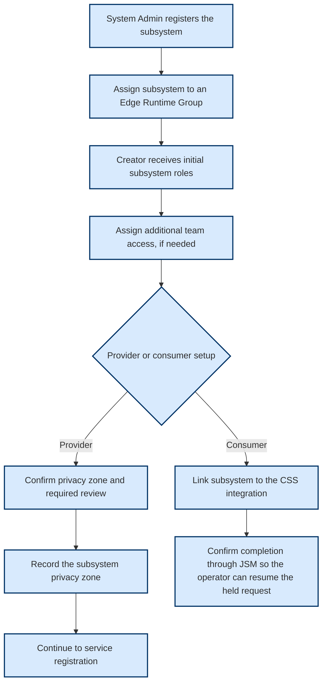

# Managing subsystems

## At a glance

**On this page:** Shared subsystem setup, the different provider and consumer setup activities, and technical reference for managing subsystems.

**When to use it:** After organization and Edge Runtime Group setup, or when managing an existing subsystem.

**Who is involved:** System Admins, Subsystem Owners, Tech Leads and Access Managers, with P2P operator support where needed.

## Subsystem setup

Subsystems represent the systems within your organization that participate
in P2P. Managing them ensures each subsystem is connected to the appropriate
Edge Runtime Group and that the right people have access to manage it.

The System Admin registers the subsystem, assigns it to an Edge Runtime Group
and manages team access through role-based access control (RBAC).

Providers and consumers share these initial activities, then complete
different setup:

- **Providers:** Confirm and record the subsystem's privacy zone. See [Service Provider Privacy Zone](#service-provider-privacy-zone).
- **Consumers:** Associate the subsystem with the CSS integration that will request access to provider services. See [Service Client Integration](#service-client-integration).



*Shared subsystem setup and the provider and consumer paths*

For consumers whose access request is held, the request was submitted through
Common Hosted Single Sign-on (CSS) and is waiting for the required P2P setup
or subsystem linking to be completed. See
[Consume a service](../consume-a-service/overview.md) for the request process.

After linking the subsystem to the CSS integration, the System Admin confirms
completion through the onboarding Jira Service Management (JSM) ticket.
The P2P operator can then resume the held access request.

Review [P2P roles and responsibilities](../sdx-roles-and-responsibilities.md)
for the roles involved and [Environments](../environments.md) when planning setup.

## Technical reference

The following sections are for System Admins registering and managing
subsystems, including runtime group assignment, team access, provider
privacy zones and consumer integration linking.

The steps described in this page are performed by the following roles:

| Role | Function |
|---|---|
| System Admin | Manage systems and service catalog entries for the particular organization |

Use cases:

- Register a subsystem
- Assign your subsystem to a runtime group
- Subsystem management
  - Administer subsystem RBAC
  - Privacy zones and Common SSO
  - Delete a subsystem

### Prerequisites

- [Install Restish CLI](/docs/default/component/aps-infra-platform-docs/reference/restish-cli/)

### Register a subsystem

=== "Restish CLI"

    Help information about the operation:

    ```sh
    restish sdx upsert-subsystem
    ```

    Example call:

    ```sh
    restish sdx upsert-subsystem \
      my-org \
      name: MY-NEW-SUBSYSTEM
    ```

=== "Reference"

    > **API** `PUT /organizations/{org}/subsystems`

    Parameters: `{org}=ministry-of-food`

    ```json
    {
      "name": "MY-NEW-SUBSYSTEM"
    }
    ```

### Assign your subsystem to a runtime group

As a System Admin, you perform this task. Once complete, you can set up routing
policies for connecting to other systems on P2P.

=== "Restish CLI"

    Help information about the operation to list available runtimes:

    ```sh
    restish sdx list-runtime-groups
    ```

    Example:

    ```sh
    restish sdx list-runtime-groups \
      my-org \
      --filter available
    ```

    Help information about the operation to assign a runtime group:

    ```sh
    restish sdx register-subsystem-gateway
    ```

    Example:

    ```sh
    restish sdx register-subsystem-gateway \
      my-org MY-NEW-SUBSYSTEM \
      runtimeGroupName: newrg
    ```

    An assigned Gateway ID will be returned. This Gateway can be used to configure
    routes and controls for services it connects to.

=== "Reference"

    To find available runtime groups for your organization, use the following API:

    - **API** `GET /organizations/{org}/runtime-groups?filter=available`

    Parameters:

    - `{org}=<your-organization>`

    After choosing a runtime group, make a note of the name.

    > If there are none returned, reach out to the P2P operator (APS Team) to find out
    > information for onboarding your organization onto P2P.

    You can now call the API to assign your subsystem to the runtime group.

    - **API** `PUT /organizations/{org}/subsystems/{name}/gateway`

    Parameters:

    - `{org}=<your-organization>`
    - `{name}=<subsystem-name>`

    ```json title="Request Body"
    {
      "runtimeGroupName": "<runtime-group-name>"
    }
    ```

    An assigned Gateway ID will be returned. This Gateway can be used to configure
    routes and controls for services it connects to.

!!! warning "Confirm the runtime currently hosts your organization"

    Registration currently succeeds with `HTTP 200` even if the chosen
    runtime group's `hostedOrganizations` no longer includes your
    organization — for example after a runtime's hosting was changed after
    you queried `list-runtime-groups`. The resulting gateway is created but
    is missing the runtime's host domain, which will cause confusing
    downstream failures when publishing services or provider patterns.
    After registering, call `get-subsystem-client` and confirm the runtime
    group actually appears in the returned `runtimeGroups` before
    proceeding.

!!! warning "Registration is create-only"

    `register-subsystem-gateway` cannot be used to repair or reconcile an
    already-registered subsystem namespace — repeating it against an
    existing namespace returns `HTTP 422 Namespace already exists`, even
    after the underlying problem (such as the missing hosted-organization
    relation above) has been corrected. Deleting the gateway to retry is not
    a safe workaround for a deterministic P2P gateway ID: it removes the
    resource set and marks the Keycloak namespace group `decommissioned`
    while the subsystem continues to reference the same gateway ID, and the
    namespace name will still be rejected as existing on a retry. Contact
    the APS team for recovery rather than deleting and recreating.

### Subsystem management

#### Administer subsystem RBAC

A subsystem's creator is granted all three roles automatically when
[assigning the subsystem to a runtime group](#assign-your-subsystem-to-a-runtime-group).
Use this operation afterward to add, change, or remove role membership -
for example when a colleague joins the team or the creator leaves the
organization.

The supported roles are:

| Role Name | Role ID | Functions |
|---|---|---|
| Subsystem Owner | `subsystem-owner` | Overall accountable owner for the subsystem |
| Tech Lead | `tech-lead` | Technical point of contact for the subsystem |
| Access Manager | `access-manager` | Manages which clients have access to services |

<!-- prettier-ignore -->
!!! warning "Updating access replaces the full member list"
    `put-subsystem-access` is a full sync, not an incremental grant: any
    member/role combination not included in the request body is **revoked**.
    To add one person without affecting anyone else, first call
    `get-subsystem-access` and include its existing members in your update
    alongside the new one.

=== "Restish CLI"

    Help information about the operation to get current access:

    ```sh
    restish sdx get-subsystem-access
    ```

    Example:

    ```sh
    restish sdx get-subsystem-access \
      my-org SUBSYSTEM-NAME
    ```

    Help information about the operation to update access:

    ```sh
    restish sdx put-subsystem-access
    ```

    Example - grants Janis all three roles and Mark `access-manager` only
    (and revokes any other role membership not listed here):

    ```sh
    echo '
    {
      "members": [
        {
          "member": { "email": "janis@testmail.com" },
          "roles": ["subsystem-owner", "tech-lead", "access-manager"]
        },
        {
          "member": { "email": "mark@gmail.com" },
          "roles": ["access-manager"]
        }
      ]
    }
    ' | restish sdx put-subsystem-access my-org SUBSYSTEM-NAME
    ```

    Confirm the change:

    ```sh
    restish sdx get-subsystem-access \
      my-org SUBSYSTEM-NAME
    ```

    Submitting a role name other than `subsystem-owner`, `tech-lead`, or
    `access-manager` returns a `4xx` naming the unsupported value.

#### Service Provider Privacy Zone

If the subsystem is going to be a Resource Server (RS) providing a service,
the subsystem MUST set its privacy zone defined in the Authorization Party (AP)
and be reviewed by the AP Owner before it can be connected to clients.

For a non-exhaustive list, see [privacy zones](https://id.gov.bc.ca/oauth2/privacy-zones).

=== "Restish CLI"

    ```sh
    restish sdx upsert-subsystem \
      my-org \
      name: MY-NEW-SUBSYSTEM, \
      privacyZone: "urn:ca:bc:gov:buseco:prod"
    ```

#### Service Client Integration

If the subsystem is going to be a Relying Party, the subsystem MUST set the
Authorization Party (AP) Integration ID to identify which access requests
this subsystem will accept from the AP.

=== "Restish CLI"

    Example setting the integration ID to `22308`.

    ```sh
    restish sdx upsert-subsystem \
      my-org \
      name: MY-NEW-SUBSYSTEM, \
      'integrations: [{integrationClientId:"22308"}]'
    ```

#### Delete a subsystem

A subsystem can be deleted when it has no active connection requests and no
gateway configuration.

If deletion succeeds, related OAS services are deleted with the subsystem.

=== "Restish CLI"

    Help information about the operation:

    ```sh
    restish sdx delete-subsystem
    ```

    Example:

    ```sh
    restish sdx delete-subsystem \
      my-org SUBSYSTEM-NAME
    ```

=== "Reference"

    > **API** `DELETE /organizations/{org}/subsystems/{name}`

    Parameters:

    - `{org}=<your-organization>`
    - `{name}=<subsystem-name>`

The delete request will not proceed if any of the following are true:

- the subsystem has active connection requests as a client
- a service under the subsystem has active connection requests
- subsystem gateway configuration exists

After a subsystem is deleted, the same subsystem name can be used again.

## Next steps

- **Providers:** Follow [Managing services](managing-services.md) to register your service.
- **Consumers:** Follow [Connecting a service](connecting-a-service.md) for access-request and connection guidance. If your request is held for setup, confirm subsystem linking is complete through your JSM ticket so the P2P operator can resume it.

Return to [Publish a service](../publish-a-service/overview.md) or
[Consume a service](../consume-a-service/overview.md) for the full journey.